# MultiPhysio-HRC: dataset exploration (2026-10-19)

What the released dataset (Zenodo 18668043) contains, and how usable it is for
estimating stress, cognitive load and affect. Generated by
`explore_dataset.py`, run with `~/.venvs/mphrc/bin/python explore_dataset.py`
(~5 min). Every number below is printed in `numbers.txt`.

## Summary: what this means for using the dataset

1. **The features mostly encode *who* the participant is.**
   - A trial's nearest neighbour comes from the same person 56-72% of the
     time (chance ~2%).
   - Participants can be identified from a single trial with 54-77% balanced
     accuracy (chance 2%).
   - Within-participant normalization is therefore mandatory, and
     cross-person generalization is the hard part.
2. **NASA-TLX (cognitive load) is the only target with a clear, learnable
   signal, and it is mostly *task identity*.**
   - The task explains 42% of NASA variance beyond the person.
   - On unseen participants, the per-participant load class is decoded at
     48-55% balanced accuracy (chance 33%).
   - The features that track NASA are largely the ones that track the task
     (e.g. the facial AU "Eyes Closed": rest and meditation are eyes-closed
     and low-load).
3. **STAI-Y1 behaves like a personal trait here.**
   - 46% of its variance is between people and only 12% is due to the task.
   - Stress classes for unseen participants are decoded at chance (34-39%
     vs 33%).
4. **The SAM affect labels are noisy.**
   - 52-64% of their variance is unexplained by person or task.
   - 15-25% of participants give almost the same answer every time (<= 2
     distinct values).
   - Arousal is mostly 1-2 on a 1-5 scale.
5. **Data quality is acceptable, with known holes.**
   - Respiration features: 14% missing values, 8% constant.
   - Extreme outliers: EDA (4.4% of values) and the EEG theta/alpha ratios
     (3.9%).
   - No facial AUs in the VR tasks; voice for only 73% of trials.
   - "VR job sim" has only 8 trials, so drop it.
6. **Small effective sample.**
   - 52 participants, 824 labelled trials (~16 per person), 2-6 minutes each.
   - The 251 physio features collapse to ~9 effective dimensions.
   - Window-level samples aren't independent: 63% of physio windows come
     from the two disassembly tasks.
7. **Repetition order is a confound in the HRC tasks.**
   - Cobot disassembly NASA drops from 27.7 to 20.1 over 5 repetitions, and
     arousal from 2.24 to 1.65.
   - Manual disassembly stays flat. Habituation and condition are entangled.

**For the FRQNT study:**
- Plan for per-participant calibration; this matches the personalization
  direction.
- Treat cognitive load (NASA-TLX) as the primary target.
- Counterbalance cobot and manual blocks.
- Always report a "task identity only" baseline next to any physiological
  model.

---

## 1. What's in it

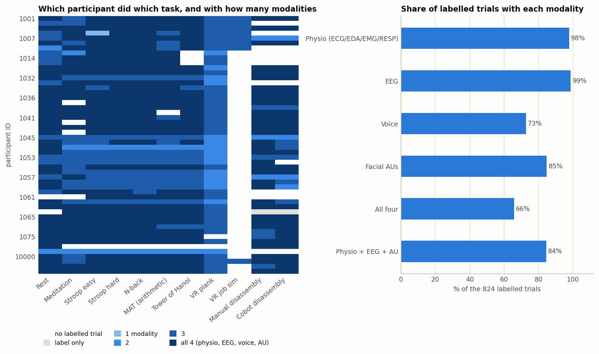

- **Scale:** 52 participants and 11 task types, 824 labelled trials after
  de-duplicating `labels.csv`.
- **Modality coverage:** physio 98% and EEG 99% of trials; facial AUs 85%
  (none during VR, where the headset hides the face); voice 73%. All four
  together: 66%.
- **VR:** "VR job sim" was run for only a handful of participants (8
  trials). Some participants (e.g. 1045-1060) have fewer modalities on the
  lab stressors.

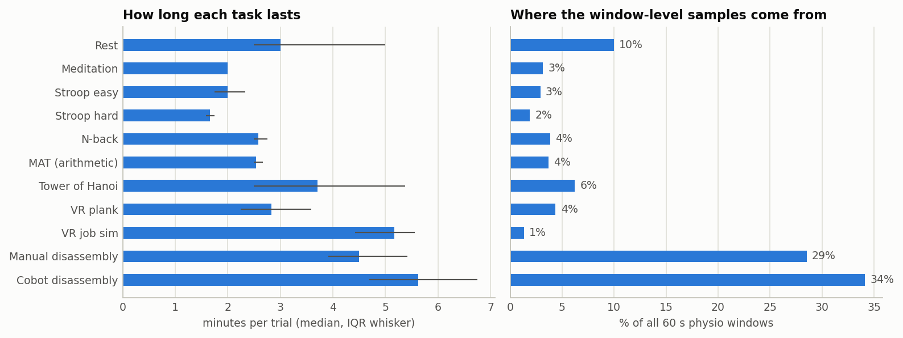

- Trials are short: median 1.7-5.6 minutes. That is only 2-5 of the 60 s
  physio windows per trial, so trial-level physiology rests on very few
  windows.
- The two disassembly tasks provide 63% of all physio windows. Any
  window-level model is dominated by them.

## 2. The labels

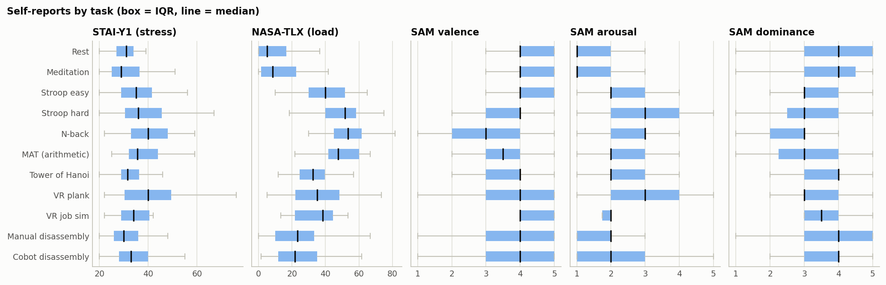

- **NASA-TLX** follows the task cleanly: rest/meditation lowest, cognitive
  tests highest, and disassembly in between.
- **STAI** barely moves across tasks.
- **SAM:** arousal is low everywhere (median 1-3); valence and dominance sit
  at 3-4 for almost every task.

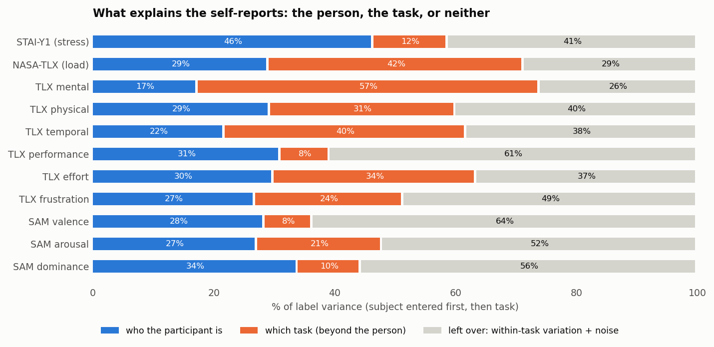

Each label's variance, split into: who the participant is, then which task
(beyond the person), then what is left over.
- **Task-driven:** NASA (42% task), TLX mental demand (57%), temporal (40%).
- **Person-driven:** STAI (46% person, 12% task).
- **Mostly unexplained:** valence (64% left over), dominance (56%), arousal
  (52%), TLX performance (61%).

Only the left-over part can carry within-task state information that a
sensor could add beyond knowing the task. For the affect labels that part is
large, but it may be mostly rating noise (see next figure).

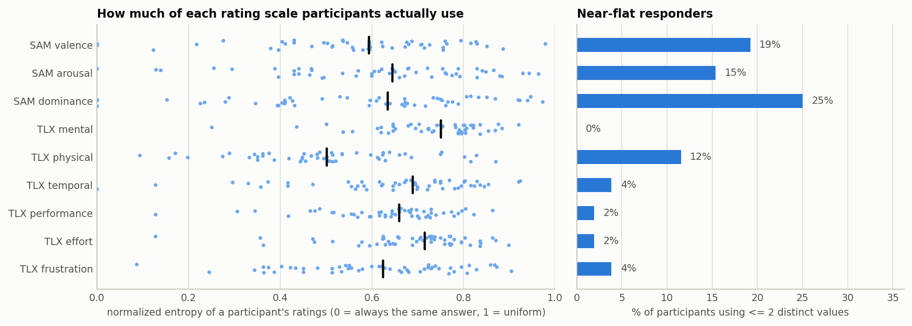

- Participants use little of the 5-point SAM scales: median normalized
  entropy is 0.59-0.65.
- 15-25% of participants are near-flat responders (<= 2 distinct values)
  on valence, arousal and dominance. For them, per-participant
  low/medium/high classes are degenerate.
- The 0-10 TLX subscales are used much more fully (0-4% flat, except
  physical demand at 12%).

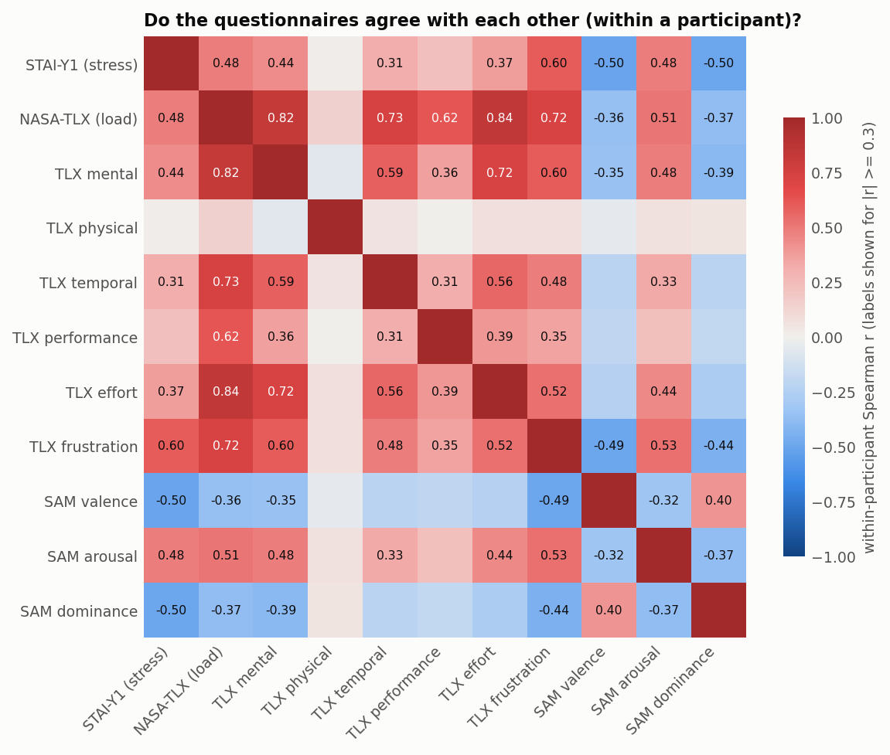

- Within a participant, the questionnaires agree moderately:
  - STAI-NASA 0.48;
  - STAI-arousal 0.48 and NASA-arousal 0.51;
  - STAI-valence -0.50.
- TLX frustration is the subscale that bridges stress and load (0.60 with
  STAI).
- TLX physical demand is uncorrelated with everything else: a separate
  dimension.

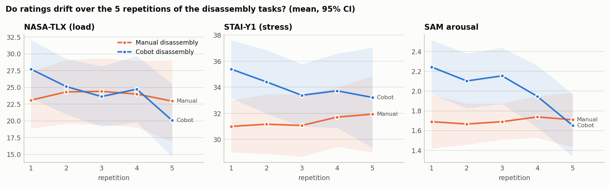

- **Cobot disassembly** shows habituation over its 5 repetitions:
  - NASA 27.7 -> 20.1;
  - STAI 35.4 -> 33.2;
  - arousal 2.24 -> 1.65.
- **Manual disassembly** stays flat, with lower stress and arousal than
  cobot from the start.
- Comparing the two conditions without modelling repetition mixes the
  robot's effect with novelty.

## 3. The features

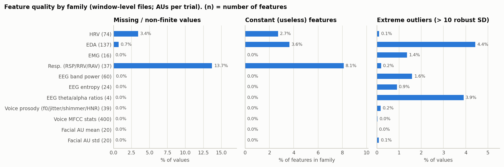

- **Missing values:** respiration features (RSP/RRV/RAV) 13.7%, of which
  8% are constant; HRV 3.4%.
  - These gaps are why `dataset._usable_columns()` silently dropped all of
    HRV/EDA/RSP before (see the main README, "Deep teacher").
- **Extreme values (> 10 robust SD):** EDA 4.4% of values and EEG
  theta/alpha ratios 3.9%. The ratios are the near-zero-denominator
  artifact found earlier; winsorize or drop them.
- **Voice and AU features are clean.**

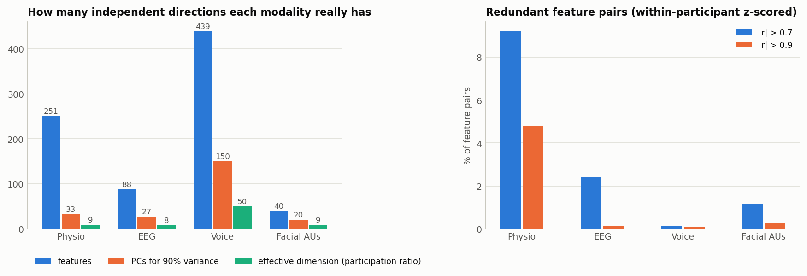

| modality | features | PCs for 90% variance | effective dimension | pairs with abs(r) > 0.9 |
|---|---:|---:|---:|---:|
| Physio | 251 | 33 | 9 | 4.8% |
| EEG | 88 | 27 | 8 | 0.2% |
| Voice | 439 | 150 | 50 | 0.1% |
| Facial AUs | 40 | 20 | 9 | 0.3% |

- Physio is heavily redundant: 4.8% of its feature pairs correlate above
  0.9, and 33 principal components hold 90% of the variance of 251
  features. Feature selection or PCA to ~30 dimensions loses little.
- Voice is the only high-dimensional modality: its MFCC statistics are
  genuinely diverse.

## 4. Similarity: person vs task vs state

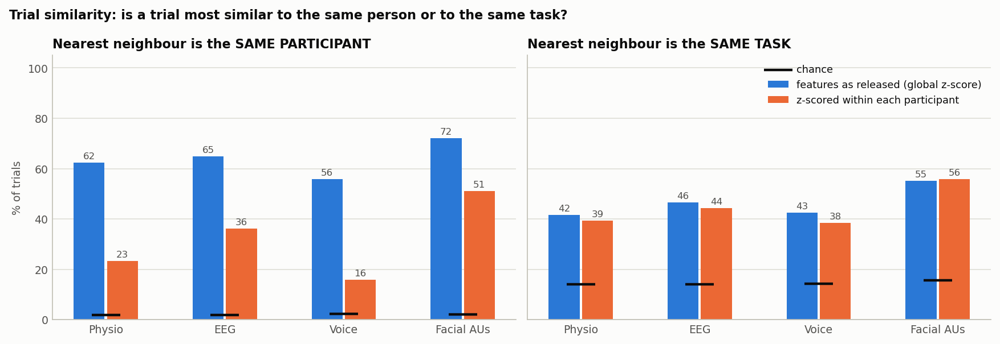

- **As released**, a trial's closest other trial (Euclidean distance on
  z-scored trial means) is from the same participant 56-72% of the time.
  Chance is ~2%.
- **Within-participant z-scoring** lowers that to 16-51%, still far above
  chance. Facial AUs stay the most person-specific (51%).
- **Same-task neighbours** run at 38-56% (chance 14%) and barely change with
  normalization. The task signal is a deviation from each person's own
  baseline, which per-participant normalization keeps.

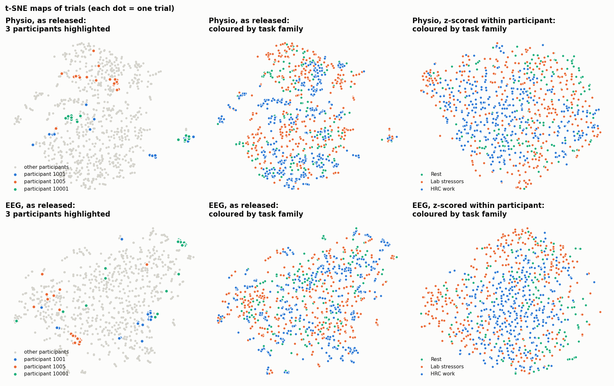

- **As released**, trials cluster by participant: the highlighted people
  form tight islands, which is exactly the fingerprint effect.
- **After within-participant z-scoring**, the islands dissolve and the task
  families (rest / lab stressors / HRC work) separate only loosely.

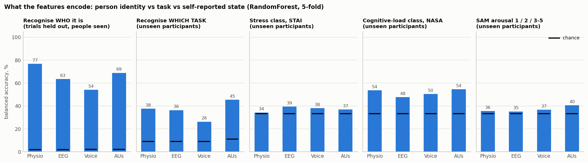

All panels use a RandomForest with 5-fold cross-validation. Except for the
identity panel, the folds hold out whole participants (as in deployment), on
within-participant z-scored features. Balanced accuracy, chance in brackets:

| decoding target | Physio | EEG | Voice | AUs |
|---|---:|---:|---:|---:|
| participant identity (2%) | **77** | 63 | 54 | 69 |
| task (9-11%) | 38 | 36 | 26 | 45 |
| STAI class (33%) | 34 | 39 | 38 | 37 |
| NASA class (33%) | **54** | 48 | 50 | **54** |
| arousal 1/2/3-5 (33%) | 36 | 35 | 37 | 40 |

These are trial-level numbers, so they aren't directly comparable with the
paper's window-level F1 (see the main README, "Reproducing the dataset
paper").

## 5. Is there state information beyond the task?

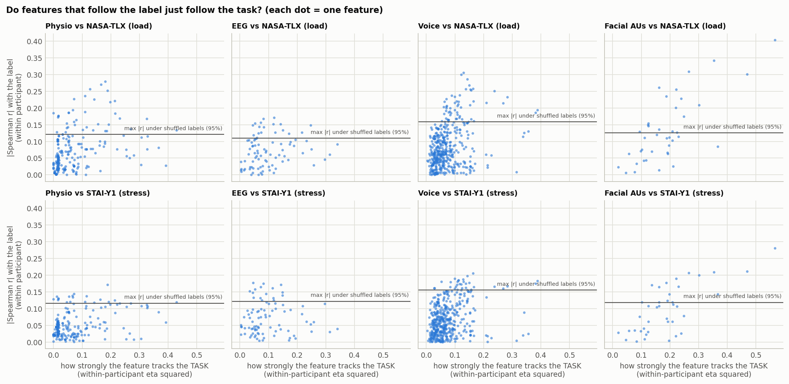

Each dot is one feature:
- x: how strongly it follows the task within a participant;
- y: its within-participant Spearman correlation with the label;
- the horizontal line: the largest correlation any feature reaches when the
  labels are shuffled within each participant (95th percentile, 200
  shuffles).

Several features in every modality clear the shuffle line (8-54 per
modality and label). But the features that track NASA/STAI/arousal tend to
be the ones that track the task: the correlation between the two axes is
0.34-0.41 for physio and 0.51-0.73 for AUs.

| strongest feature | NASA | STAI | Arousal |
|---|---|---|---|
| Physio | HRV_IALS (0.28) | HRV_MFDFA_alpha1_Peak (0.17) | HRV_PI (0.18) |
| EEG | EEG_1_Alpha (0.17) | EEG_5_Theta (0.18) | EEG_5_Alpha (0.22) |
| Voice | mean_MFCCs_11 (0.31) | f1_median (0.21) | std_MFCCs_74 (0.29) |
| AUs | Eyes Closed (0.40) | Eyes Closed (0.28) | Eyes Closed (0.29) |

"Eyes Closed" being the top AU for every label is the clearest task
confound. Rest and meditation are eyes-closed, low-load, low-stress tasks.

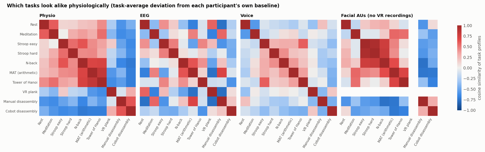

How alike each pair of tasks is, as the cosine similarity of their average
deviation from each participant's baseline:
- **Physio** separates three regimes: rest/meditation, the cognitive tests
  (Stroop/N-back/MAT/Hanoi, similar to each other), and the disassembly
  tasks (opposite to both). VR plank sits on its own.
- **AUs** group the screen-based tests (Stroop easy/hard, N-back) very
  tightly.
- **EEG and voice** show weaker, less structured task patterns.

## 6. Is the heart-rate signal usable? (`inspect_heart_rate.py`)

Heart rate is computed per 60 s window as HR = 60000 / median beat-to-beat
(RR) interval. A window counts as an *artifact window* if it contains an RR
interval more than 30% shorter (a falsely detected extra beat) or 30% longer
(a missed beat) than its median. This is the standard RR-artifact rule. The
raw ECG isn't downloaded, so this works from the released window features.
Numbers: `hr_numbers.txt`.

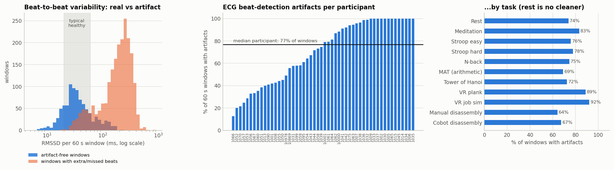

- **70% of the 3,015 windows contain beat-detection artifacts**: 62% have an
  extra/false beat and 55% a missed beat.
- In artifact-free windows the variability is healthy (median RMSSD 32.5 ms,
  typical 20-60 ms). In artifact windows it is 202 ms, which is not
  physiological.
- Only 1 of 52 participants has under 20% artifact windows; 24 have over
  80%, and the median participant has 77%.
- Rest (74%) and meditation (83%) are no cleaner than the active tasks, so
  this is a recording or beat-detection problem, not movement.
- **Consequence:** the 72 variability features (RMSSD, SDNN, pNN50, LF/HF,
  nonlinear indices) mostly measure detection errors. This is why the
  HR+EDA models scored so poorly.

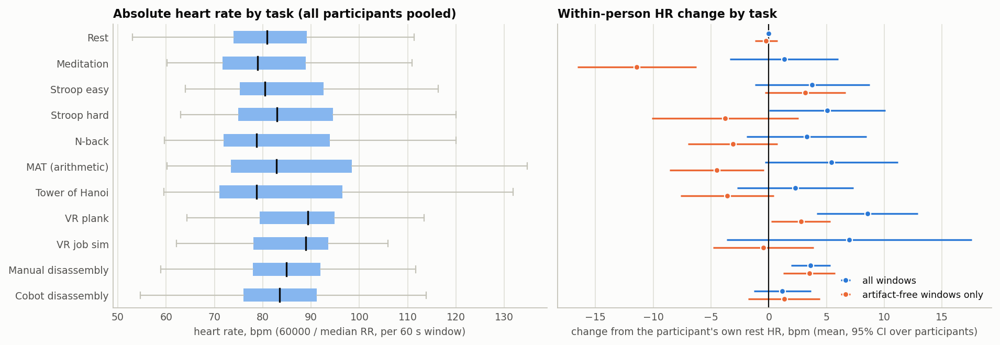

- **Heart-rate level is plausible:** 55-152 bpm, median 84.
- **Within-person changes from rest point the expected way:**
  - VR plank +8.5 bpm, MAT +5.4, Stroop hard +5.1, Stroop easy +3.8, N-back
    +3.3;
  - manual disassembly +3.6, cobot disassembly +1.2.
- **But they are small and uncertain** (95% CI about +/-5 bpm for most
  tasks).
- **The clean subset can't confirm them.** Using only artifact-free windows
  leaves 9-30 participants per task, and the directions flip (meditation
  -11, the cognitive tests -3 to -5).

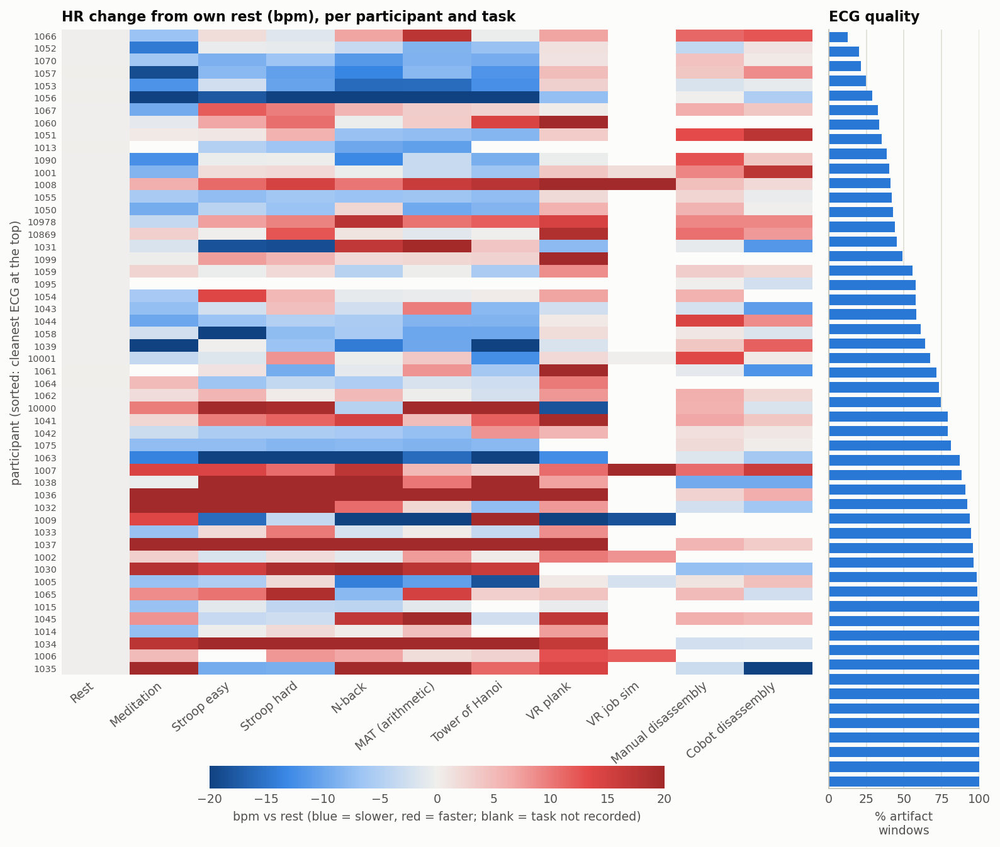

Per participant, the task responses are inconsistent. Some people show a
faster heart rate in every task, others a slower one, and the cleanest-ECG
participants (top rows) don't show a clearer pattern than the noisiest.

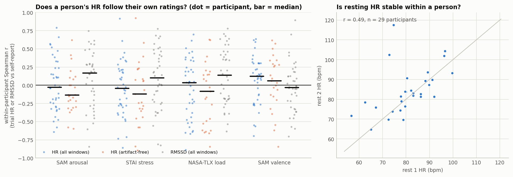

- **HR doesn't follow a person's own ratings.** The within-participant
  correlation between trial HR and the self-report has a median of:
  - -0.03 for arousal, -0.05 for STAI, 0.03 for NASA, 0.12 for valence;
  - about the same or worse with artifact-free windows only.
- RMSSD correlates *positively* with arousal (0.17) and NASA (0.14). Stress
  normally *lowers* RMSSD, so this is the wrong direction. RMSSD here
  follows the artifact rate, which differs between tasks.
- **Resting HR isn't stable within a person:** rest 1 vs rest 2 correlate
  only at r = 0.49, with a mean absolute difference of 7.1 bpm (29
  participants). Well-measured resting HR usually agrees far better.

**Is it because one questionnaire label covers a whole 2-6 minute trial?**
Not mainly.
- No part of the trial's HR tracks the ratings better than its mean: the
  first window, the last window (just before the questionnaire), the max,
  the min and the range all give median within-participant r between -0.15
  and +0.15.
- The 13 participants with the cleanest ECG (< 50% artifact windows) show HR
  *negatively* related to NASA load (r -0.33 to -0.39). HR follows physical
  activity: the disassembly tasks involve standing and handling parts, while
  the cognitive tests are seated but rated the most demanding.
- Label granularity is still a limit for any model: one retrospective rating
  gives 2-5 windows per label and no within-trial supervision. That is why
  models here work at trial level.

**Verdict:** the HR channel in this release is not a healthy signal to learn
from.
- The variability features are artifact-dominated.
- The HR level is noisy and barely tracks the labels.
- **What would fix it:** re-detect the R-peaks from the raw ECG
  (`physiological_data.zip`, 15 GB) with artifact correction, e.g. NeuroKit2
  `ecg_peaks(..., correct_artifacts=True)`. Then recompute HR/HRV and redo
  this check.
- **Without that:** use at most the HR level and RMSSD from artifact-free
  windows, and treat EDA and facial AUs as the main signals.
- **For our own study:** monitor ECG quality live during recording, or use a
  chest strap that outputs RR intervals, and log a per-window artifact rate.
